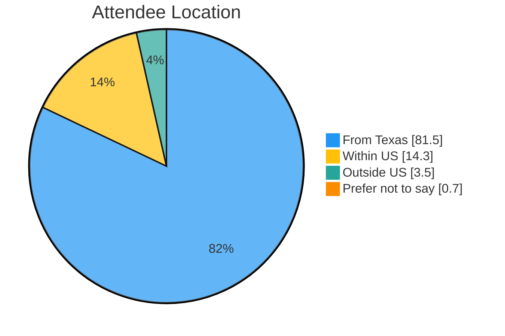
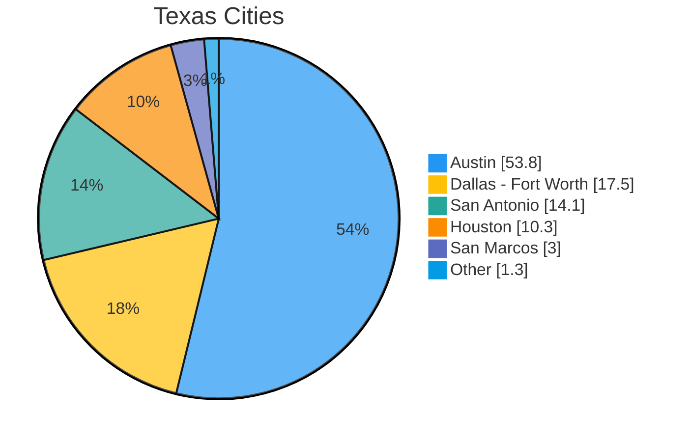
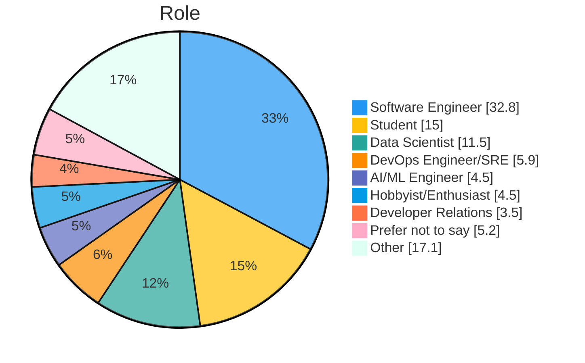
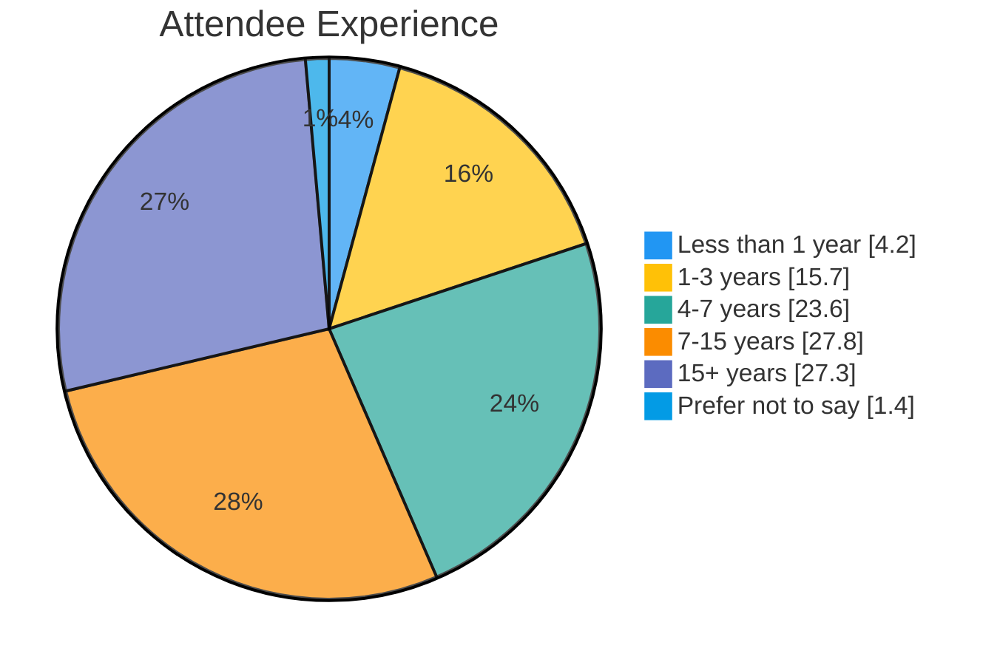
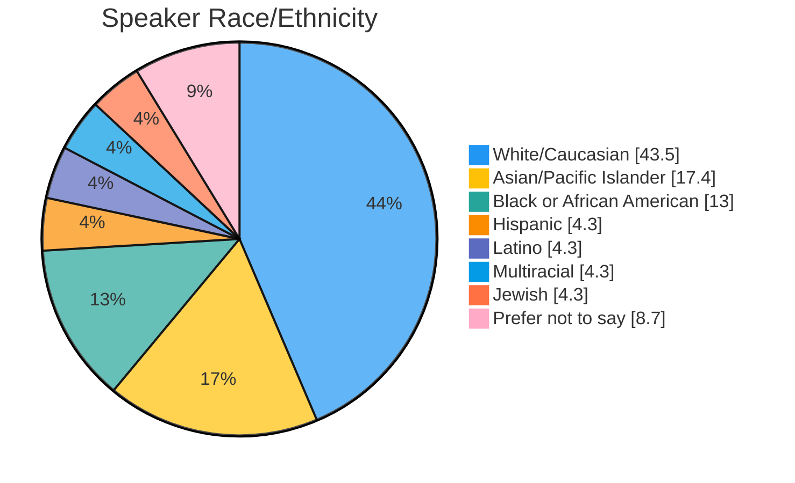
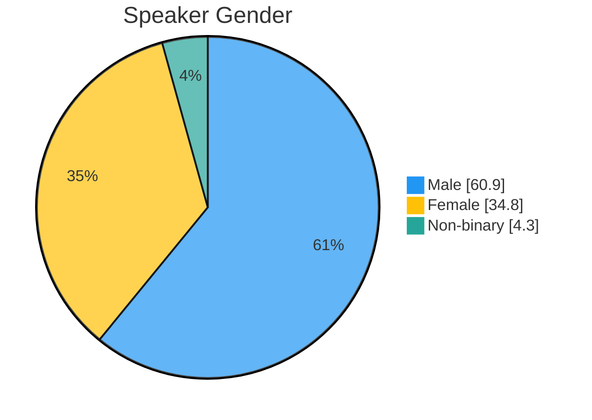
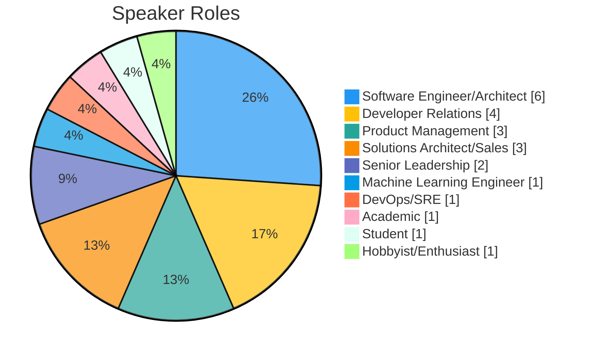
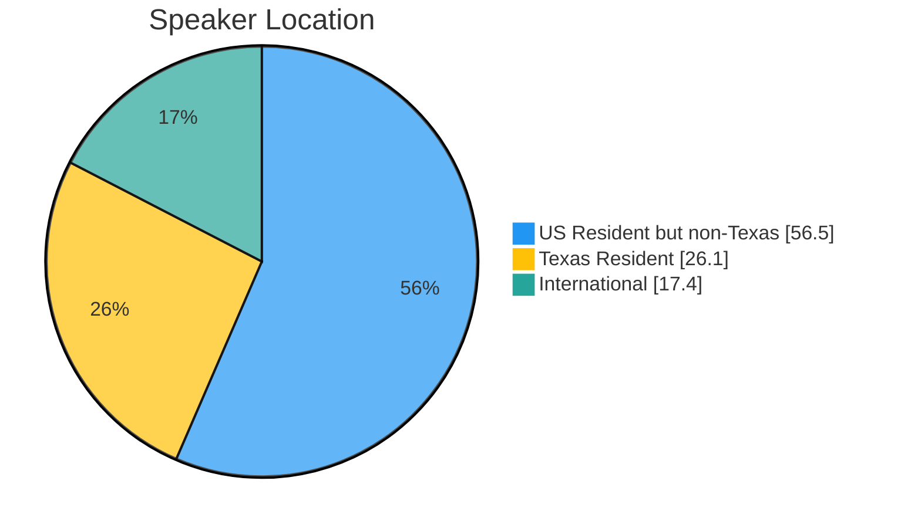

Well, better late than never, I guess.
Sorry for the delay in the recap.
It's been a wild year.
The 20th annual PyTexas Conference took place April 17 - 19, 2026 at the Austin Central Library in Austin, TX, and here I am publishing this the week of Thanksgiving.
So in the spirit of the season, the organizing team and I want to say thank you to everyone who made our 20th year the spectacular celebration that it was.
As is tradition, here's the behind-the-scenes data.

<!-- more -->

## PyTexas 2026 Conference

2026 marked the 20th year of PyTexas.
What started as PyCamp Texas at Rice University back in 2007 (1) is now one of the oldest regional Python conferences in the world and the oldest in North America.
So this year we celebrated.
We made special swag, held two nights of after-hours events on the library's rooftop garden, and created more time and space for the community to interact with each other.
So, here's how it went.
{ .annotate }

1. For those coming at me with the math, you start counting here at 1, not 0.

## What Was New This Year?

The philosophy of PyTexas is incremental change.
Every year we try to identify a few ways to make things better, then implement them.
This allows us to continue to bring improvements while honoring our history, not overwhelm ourselves, and most importantly, we can get feedback from the attendees.
Here's what changed this year.

### New Space

For the first time since we started hosting the conference at the library, we were able to expand our footprint.
One of the questions that I get asked often is why doesn't PyTexas have a multi-track conference?
There are multiple reasons for it, but the largest one is that we just don't have the space.
We've always known about other space within the library, but it's been very challenging to schedule around it.
So this year we decided to rent out the Demonstration Area.
This is an area adjoining the back of our venue with an amphitheater and a television, but it is open to the rest of the library.
That means anybody on the second floor or on the stairs could listen and hear (which I don't really care about), but more importantly, any noise would flood in.
This makes it an unsuitable venue for live talks where we're trying to record anything.
But this year we got creative and found a way of using the space that we think our attendees enjoyed.

#### A Coffee Bar

In the mornings, we used the space for what was probably our most popular addition this year, a live coffee bar.
We brought in a local vendor, Doxa Coffee, to run a full coffee bar with baristas, and to say it was a hit would be an understatement.
This was a success on two fronts.
First, the attendees absolutely loved it, and it gave people a place to congregate and chat.
It also removed a lot of the operational burden from the organizers, who have spent a lot of time picking up catering, maintaining the coffee area, and cleaning it up.
This way, everything was taken care of and attendees got a noticeably better experience.
This is definitely something that we will be bringing back in the future.

#### Open Spaces

In the afternoons, we decided to use the space for Open Spaces.
This was the first year since moving to the library that we had [Open Spaces](https://www.pytexas.org/2026/schedule/open-spaces/).
Open Spaces are self-organized sessions where the topic is proposed and voted on by the attendees.
After the Saturday keynote, attendees submitted topic ideas, voted on them, and then met after lunch.
The sessions ran in parallel with the afternoon talks, so people could move freely between the main track and Open Spaces.
We ran 8 Open Spaces sessions across the two days, on topics ranging from Python packaging and managing multiple coding agents to setting students and beginners up for success with AI.
The feedback from attendees was that this was a great addition, and people were adamant that we bring them back in 2027.
Feedback heard loud and clear, and we look forward to having it again in 2027.

### Sponsored Tutorials

For the third year in a row, we have invited prominent community members to give tutorials on the Friday prior to the main conference.
This year we had two amazing tutorials, [Import is Important: The Secret Life of Python Modules and Packages](https://www.pytexas.org/2026/schedule/tutorials/#import-is-important-the-secret-life-of-python-modules-and-packages) from Heather Crawford and [Becoming a Better Python Developer with AI](https://www.pytexas.org/2026/schedule/tutorials/#becoming-a-better-python-developer-with-ai) from Bernát Gábor.
This year we also decided to try sponsored tutorials for the first time.
Microsoft delivered two hands-on sessions, one on agentic AI with Semantic Kernel and Graph RAG on PostgreSQL and one on building a full-stack FastAPI app with open source DocumentDB.
This did cause some interesting scheduling challenges, but in the end we got it to work, and I believe that overall the sponsored tutorials were a success.
We will be reevaluating the process for these and deciding whether to do them again next year.

### Two Nights on the Rooftop

Speaking of adding new space this year, we decided to try our networking event at a venue we've struggled to book in the past.
That venue just happens to be the rooftop garden on top of the library.
This area has a beautiful view of downtown Austin and Lady Bird Lake.
We held two events there over the course of the conference.
On Friday night we held our appreciation event for speakers, sponsors, organizers, and Friends of PyTexas.
The following night we held the Network Event, sponsored by [GitButler](https://gitbutler.com/).
Both nights were catered with some amazing food, and we learned a lot in the process of getting this all set up.
Stay tuned to see where we'll hold these two events next year!

### 20th Anniversary Swag

To mark 20 years we went all out for swag this year.
We made conference logo patches, new enamel pins, and introduced our new mascot, Davy Quackett, a cowboy rubber duck with the PyTexas logo.
Every attendee got a patch and a Davy Quackett as part of their attendance, and the enamel pins were available for purchase.
For our speakers, we had custom embroidered aprons as a thank-you gift.
Last year in our recap, we mentioned that there was a swag item that we tried to make that we ended up shelving for this year.
Surprise, surprise, it was Davy Quackett.

### Speaker Feedback

New this year, we collected attendee feedback for every talk through Slido and delivered it to the speakers.
Several speakers told us they appreciated it, so we'll keep doing it and set it up earlier next year.

## Attendance

2026 was yet another sell-out year.
We sold **289** conference tickets, **275** in person and **14** virtual.
We had **238** in-person attendees check in, giving us an 87% attendance rate, which is the highest we've ever calculated.

A few more statistics:

* 59% of attendees were attending PyTexas for the first time.
    * This number is actually trending down:
        * 70% 2024
        * 60% 2025
    * This indicates to us that our attendees are enjoying the conference and making an effort to return year over year.
* 213 Network Event tickets sold
* 164 tutorial tickets sold, with 114 attendees checked in on Tutorial Day
* 101 T-Shirts sold

### Statistics

**Location**

* **81.5%** of attendees were from Texas
    * **53.8%** from Austin
    * **17.5%** from Dallas - Fort Worth
    * **14.1%** from San Antonio
    * **10.3%** from Houston
    * **3.0%** from San Marcos
    * **1.3%** from other areas in Texas
* **14.3%** are from other states within the United States
* **3.5%** were from outside the United States

**Roles**

* **32.8%** - Software Engineer
* **15.0%** - Students
* **11.5%** - Data Scientist
* **5.9%** - DevOps/SRE
* **4.5%** - AI/ML Engineer
* **4.5%** - Hobbyist/Enthusiast
* **3.5%** - Developer Relations
* **5.2%** - Prefer not to say
* The rest consists of Marketing/Business, Senior Leadership, Security, Testing, Academics, Product Management, Solutions Architects, Founders, and People Managers

**Experience**

* **4.2%** - Less than 1 year
* **15.7%** - 1 to 3 years
* **23.6%** - 4 to 7 years
* **27.8%** - 7 to 15 years
* **27.3%** - 15+ years

**Looking for a Job?**

This year we asked attendees whether they were looking for a job, so we could encourage recruiters to attend.

* **38.3%** - Yes
* **52.6%** - No
* **9.1%** - Prefer not to say

This is the first year we ever asked this question, and honestly, I wish I had asked it years before.
Because this feels inordinately high.
Even without the `Prefer not to say` (1) folks, nearly 40% of our community was looking for a job.
It's quite the picture of what is going on in our industry right now.
{ .annotate }

1. Which, my guess is, a majority of that falls into the `Yes` bucket.

### Our Thoughts on Ticket Sales

Most of what we've seen in past years held true again, with a couple of changes.

* Early bird still brings in the folks who come every year.
  Tickets went on sale on December 28, and January was our strongest month before April, with 55 paid tickets sold by the end of the month.
* Announcements drive ticket sales.
  The weeks we announced our accepted talks and tutorials in mid-January were the two best weeks of the winter.
    * Unlike last year, releasing the full schedule in mid-February didn't produce a bump.
    * However, we did a staggered release of talks this year, slowly highlighting speakers, so we think this is the cause.
* **Most of your tickets will sell in the final month.**
    * 51% of our paid tickets sold in the final 30 days, counting through the conference weekend.
    * Those final 30 days sold nearly three times as many tickets as any earlier 30-day stretch.
    * 66% sold in the final two months, and 85% sold in the final three months.
    * 23 tickets sold on the Saturday of the conference itself.
    * If your sales look slow two months out, you're not doomed.
      You're normal.
* Newsletters helped most when they had something to say.
    * The January newsletter went out right before we announced our talks and tutorials, leading to a spike.
    * February and March we didn't have much to say, so no observable spike.
    * The April newsletter landed in the final month before the conference, reminding people to buy tickets, which led to a spike.

We also sold 53 student tickets this year, nearly filling our student allocation of 55, which we love to see.

<!-- Source: paid admission tickets from the pretix API (232 paid, comps excluded), compared against newsletter send dates (first Monday of the month) and the 2026 site's git history for announcement dates (keynotes 12/29, talks 1/15, tutorials 1/17, schedule 2/14). -->

## Sponsors

For the second year in a row, sponsorship set a new record for PyTexas.
Sponsorship money is what lets us keep ticket prices low, fund opportunity grants, and keep the Foundation's programs running between conferences.
We owe every one of these companies a huge thank you.

Thank you so much to this year's [sponsors](https://www.pytexas.org/2026/sponsors/):

* Platinum
    * [Microsoft](https://www.microsoft.com/en-us/)
    * [Temporal](https://temporal.io/)
    * [Anaconda](https://www.anaconda.com/)
* Gold
    * [Elastic](https://www.elastic.co/)
* Networking Event
    * [GitButler](https://gitbutler.com/)
* Lanyard
    * [Bloomberg Engineering](https://www.bloomberg.com/company/values/tech-at-bloomberg/)
* Community
    * [Black Python Devs](https://blackpythondevs.github.io/)
* Media & Technology
    * [devIT](https://devitjobs.com/jobs/python/all/all)
    * [pretix](https://pretix.eu/)

### Statistics

This year we brought in a record **$46,000** from seven sponsors, up from the $40,750 we reported last year.
For the first time we sold three Platinum sponsorships in a single year, and those three sponsors alone covered $33,000.

We didn't sell a live captioning sponsorship this year, but we kept it because of feedback that it made a big difference for many folks.

## Finances

PyTexas 2026 cost **$64,497.28** to operate.
This is the most expensive conference we've ever run, and we knew that going in.
We decided to celebrate the 20th year with a bang, and thankfully the community and sponsors showed up for us.
The largest budget items for us were swag (including the 20th anniversary items), venue, the two rooftop evenings, and A/V.
We sold tickets of varying cost, including add-ons such as shirts, swag, tutorials, the Network Event, and donations, and made **$31,368.00** in gross revenue (prior to fees).
Together with **$46,000** from sponsors, total revenue was **$77,368.00**, which leaves the conference about **$12,871** in the green.

Donations were also up this year.
Several attendees signed up as [Friends of PyTexas](https://www.pytexas.org/sponsorship/friends/) at the conference.
We also ran an experiment of raising the default value of the optional donation amount when you purchase a ticket from $5 to $10.
Of the 20 people who opted to donate, 16 gave this amount.

As always, all excess funds from this year will be used to fund ongoing PyTexas Foundation programs such as the meetup, infrastructure costs, grants, and any future PyTexas event (such as the [PyTexas 2027 Conference](https://www.pytexas.org/2027/)).

## Speakers

This year we welcomed [Dawn Wages](https://www.pytexas.org/2026/schedule/keynotes/#dawn-wages) and [Hynek Schlawack](https://www.pytexas.org/2026/schedule/keynotes/#hynek-schlawack) to keynote our 20th year.
These are two fantastic members of the Python community, and it was an honor to have them join us.
We constantly received feedback about how much people enjoyed this year's keynotes.

Along with the keynotes, we had 17 talks, 4 tutorials, and lightning talks on both Saturday and Sunday.

### CFP Statistics

The CFP opened in early October 2025 and we received **99 submissions from 75 speakers**.
That's nearly identical to last year's 100 submissions from 74 speakers.

* 99 submissions from 75 speakers from a wide variety of backgrounds.
    * 11 indicated they were first time speakers
    * 50 indicated they had never spoken at PyTexas before
* We accepted 15 talks and kept a waitlist of 11 more, which let us fill any last minute withdrawals.

Just like last year, the vast majority of submissions came in at the very end.
Our original deadline was December 7, and 18 proposals arrived on that day alone.
We extended the deadline to December 12 and received another 15 proposals in those five days.

<!-- Source: pretalx API, pulled 2026-11-10. -->

### Speaker Statistics

This year we had 23 speakers on stage, including our keynotes, tutorial presenters, and sponsor talks.
Here's a more in-depth breakdown of this year's speakers:

#### Speaker Race/Ethnicity

* **43.5%** - White/Caucasian
* **17.4%** - Asian/Pacific Islander
* **13.0%** - Black or African American
* **4.3%** - Hispanic
* **4.3%** - Latino
* **4.3%** - Multiracial
* **4.3%** - Jewish
* **8.7%** - Prefer not to say

#### Speaker Gender

* **60.9%** - Male
* **34.8%** - Female
* **4.3%** - Non-binary

Last year our representation across genders was lacking.
We are happy to say that this year progress was made.

#### Speaker Professional Role

* **6** - Software Engineer/Architect
* **4** - Developer Relations
* **3** - Product Management
* **3** - Solutions Architect/Sales
* **2** - Senior Leadership
* **1** - Machine Learning Engineer
* **1** - DevOps/SRE
* **1** - Academic
* **1** - Student
* **1** - Hobbyist/Enthusiast

#### Speaker Location

* **56.5%** - Outside of Texas but within the United States
* **26.1%** - Texas Resident
* **17.4%** - International

## Opportunity Grants

Every year we offer opportunity grants to community members who request assistance to attend PyTexas.
It is our goal to increase this number every year for as long as we can.
This year we were able to raise the number _yet again_ and provided **$5,045** in opportunity grant funding.
We received 26 applications and were able to help 9 individuals.
We also gave 3 more applicants complimentary tickets.
And in typical fashion, we had a 100% attendance rate of those we provided grants to.
We have been saying it for years, and we'll keep saying it: money is **_never_** a reason you shouldn't be able to attend PyTexas.

And while we couldn't provide financial assistance to every applicant, we provided free virtual tickets to every person who applied for assistance so they could watch and interact with the conference, regardless of their location.

## Our Observations as Organizers

A few more notes:

- Y'all still really like bananas...
    - We bought three crates, about 150 lbs, up from more than 50 lbs in 2025, and still ran out.
- We got access to the library's catering kitchen this year, and it made a huge difference.
  We're planning a lot around it in the future.
- Check-in was faster without the on-site demographics form, but it created a new bottleneck by overworking Laura.
  We need to optimize registration again.

## Conclusion

Twenty years in, and PyTexas is still going strong.
We're immensely humbled every year that the community continues to come back and spend time with each other.
Thank you for being part of it.

All recordings of the talks can be found on the [PyTexas 2026 website](https://www.pytexas.org/2026/schedule/) or on our [YouTube Channel](https://www.youtube.com/playlist?list=PL0MRiRrXAvRh0bfHGatkL10oI682zH0-F).

Be sure you join us for the 21st year of PyTexas next year!
The [PyTexas 2027](https://www.pytexas.org/2027/) dates have already been set, and we'll be returning to the [Austin Central Public Library](https://library.austintexas.gov/central-library) April 16 - 18, 2027.

We hope to see y'all there!
