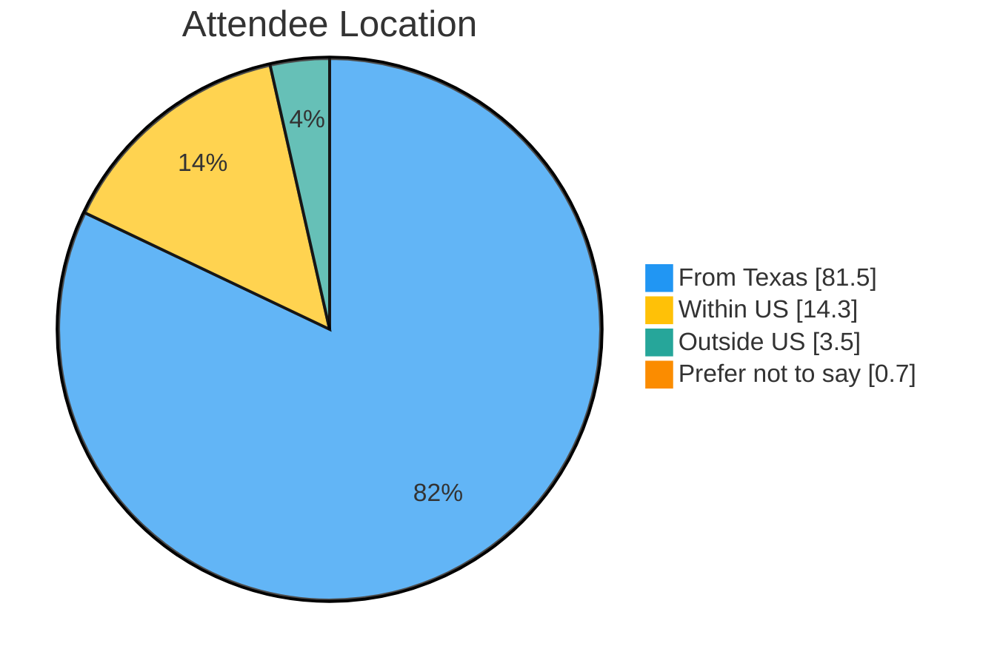
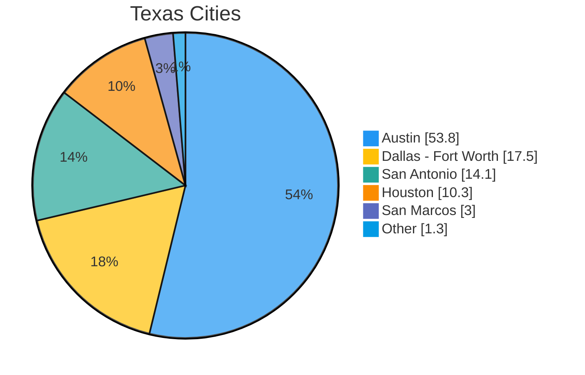
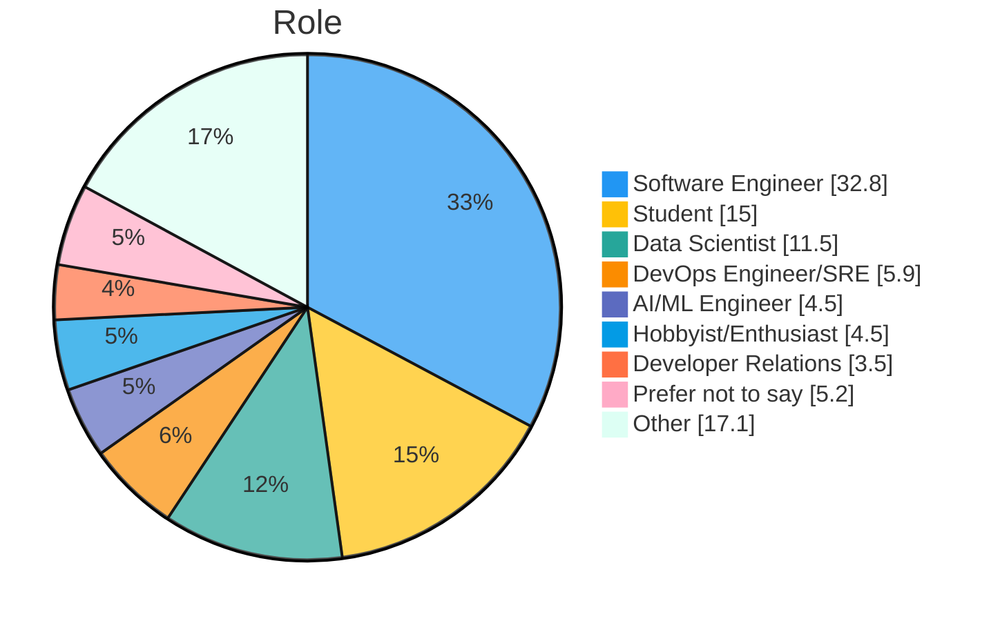
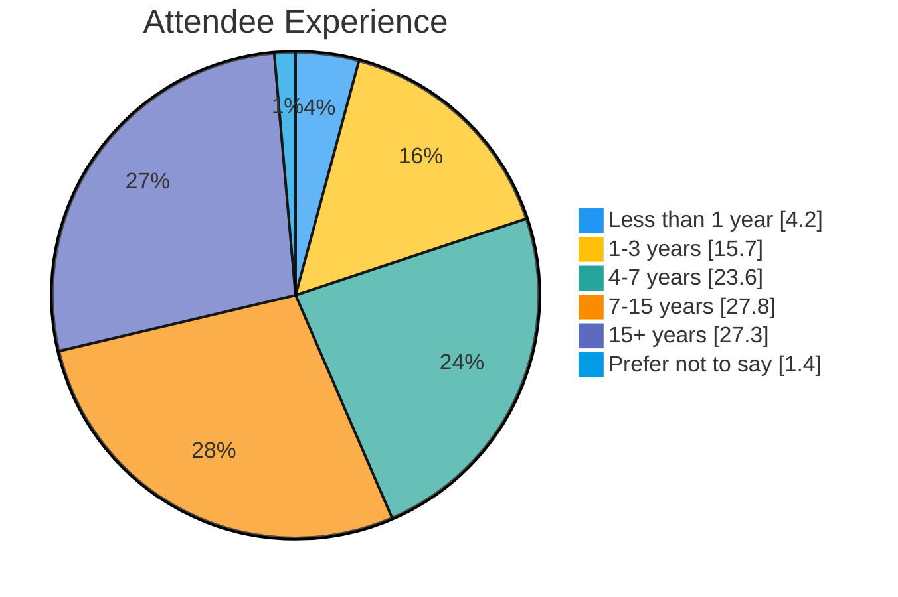
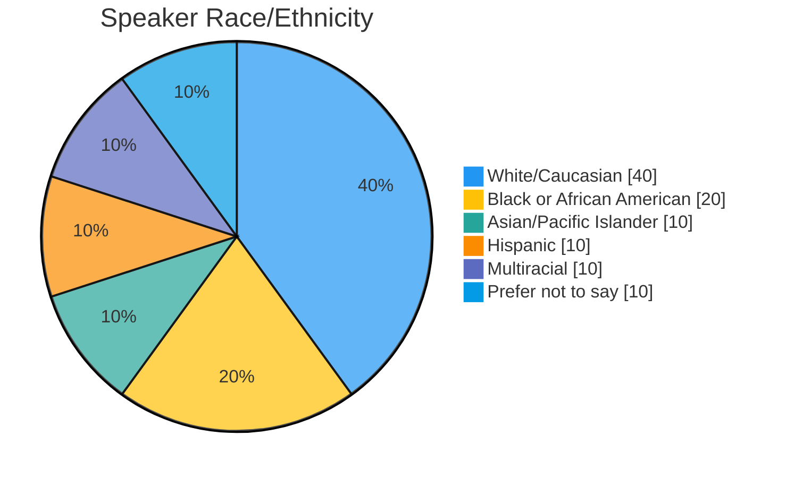
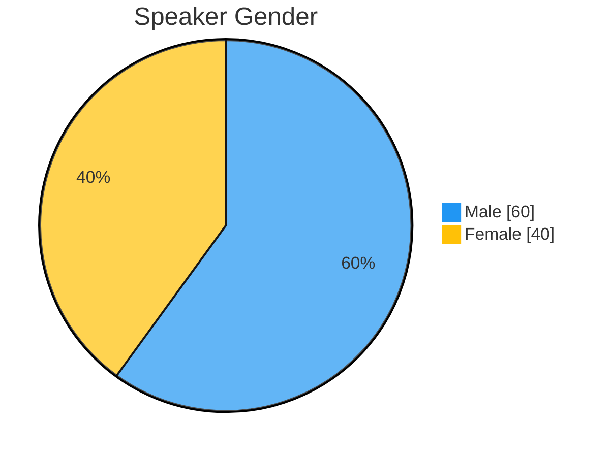
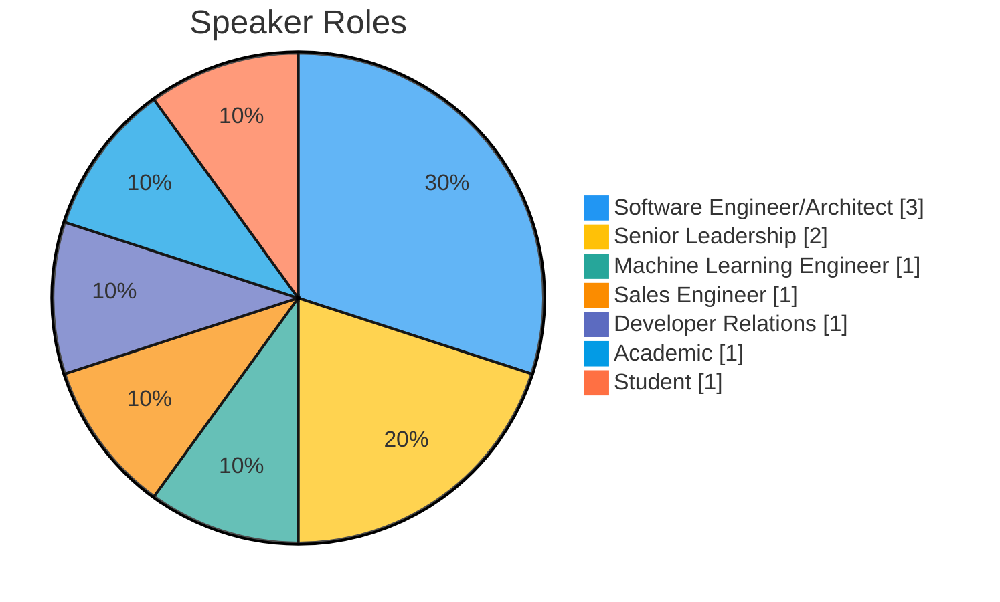
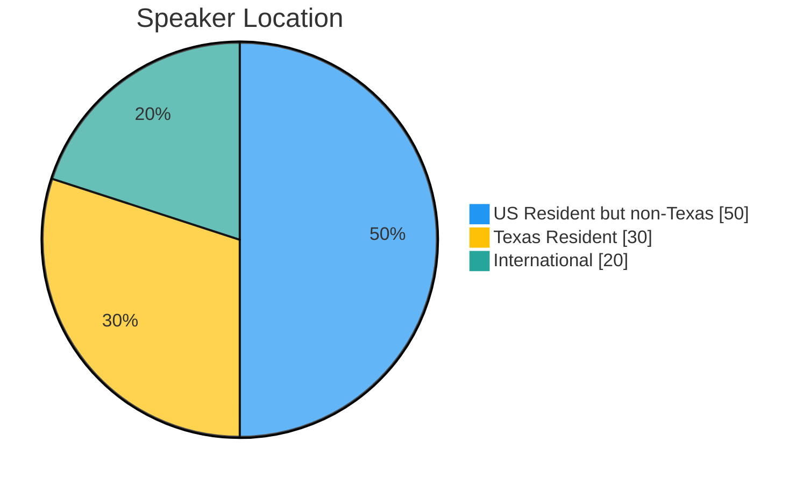

The PyTexas Foundation held the 20th annual PyTexas Conference at the Austin Central Library on April 17 - 19, 2026 in Austin, TX.
Twenty years after _PyCamp Texas_, we sold out, had a record year for sponsorship, and tried a few new ways to connect.
We're excited to share some behind the scenes data with you.

<!-- more -->

## PyTexas 2026 Conference

The 20th year of PyTexas was a celebration.
We marked the anniversary with special swag, two nights on the library's rooftop, and more time built into the schedule for people to talk to each other.
<!-- TODO(Mason): add a sentence or two of your own on what the 20th year meant to you. -->
Let's get into PyTexas 2026.

## What Was New This Year?

As we've said before, PyTexas has a philosophy of incremental change.
We pick a few things to improve each year rather than flipping the table on what has worked for two decades.
Here's what we changed this year.

### Open Spaces

This was the first year PyTexas hosted [Open Spaces](https://www.pytexas.org/2026/schedule/open-spaces/).
Open Spaces are self-organized discussion sessions where attendees set the agenda.
After the Saturday keynote, attendees submitted topic ideas at the registration desk, voted on them over lunch, and then met in the library's demo space on Saturday and Sunday afternoons.
The sessions ran in parallel with the afternoon talks, so people could move freely between the main track and Open Spaces.
Open Spaces worked well in the demo space, and next year we plan to announce them earlier and more often so more people know they're happening.
<!-- TODO(Mason): how many Open Spaces sessions ran, and what were a couple of the topics? -->

### Sponsored Tutorials

We kept tutorials on the schedule with two community tutorials, [Import is Important: The Secret Life of Python Modules and Packages](https://www.pytexas.org/2026/schedule/tutorials/#import-is-important-the-secret-life-of-python-modules-and-packages) from Heather Crawford and [Becoming a Better Python Developer with AI](https://www.pytexas.org/2026/schedule/tutorials/#becoming-a-better-python-developer-with-ai) from Bernát Gábor.
This year we also added sponsored tutorials for the first time.
Microsoft delivered two hands-on sessions, one on agentic AI with Semantic Kernel and Graph RAG on PostgreSQL and one on building a full-stack FastAPI app with open source DocumentDB.
Tutorials were popular, with 261 tutorial seats across bundles and paid, student, free, and day-of tutorial tickets.

### Two Nights on the Rooftop

After moving the Network Event to Remedy last year, we brought it back to the venue this year.
For the 20th anniversary we booked the library's [Rooftop Garden](https://library.austintexas.gov/node/1734923) for both Friday and Saturday nights.
Friday night was our appreciation event for speakers, sponsors, and organizers, and Saturday night was the Network Event, sponsored by [GitButler](https://gitbutler.com/).
213 people registered for the Network Event, and 135 checked in.

### Be-Free Lunches

Instead of catered lunch on site, we gave attendees a long lunch break and organizers led groups to restaurants around downtown Austin.
It turned lunch into one more chance to meet people, and we plan to recruit volunteer lunch leads next year so organizers aren't stretched as thin.
<!-- TODO(Mason): confirm be-free lunches were new in 2026. -->

### A Coffee Bar

We brought in Doxa Coffee to run a coffee bar with baristas, and it was a hit.
Organizers spent less time refilling coffee urns, and the coffee line in the demo space turned into a hallway track of its own.
<!-- TODO(Mason): add a link to Doxa if you want one. -->

### 20th Anniversary Swag

To mark 20 years we made anniversary patches, enamel pins, and rubber ducks, and every attendee got their shirt bagged and bundled with their badge in a PyTexas tote.
Speakers received PyTexas aprons as a thank-you gift.
<!-- TODO(Mason): last year's post promised "an even more awesome item" for the 20th year. Which item was it? Call it out here. -->

### Speaker Feedback

New this year, we collected attendee feedback for every talk through Slido and passed it along to the speakers.
Several speakers told us they appreciated getting it, so we'll keep doing it and set it up earlier next year.

## Attendance

2026 was a sell-out year.
We sold **289** conference tickets, **275** in person and **14** virtual, and our in-person capacity of 275 sold out.
**238** in-person attendees checked in over the weekend, an 87% attendance rate.
<!-- TODO(Mason): all numbers in this section are from the pretix API (paid orders, the 18 admission products, pulled 2026-11-10). Your closing deck said 253 checked in and 90%. pretix shows 238 of 275 in-person tickets with a check-in on any list. The deck also said capacity went from 250 to 275. The quota is 275 today, but the API can't show its history, so I left the 250 out. -->

59% of this year's attendees were attending PyTexas for the first time.
That number has been trending down, from 70% in 2024 to 60% in 2025 to 59% this year, which tells us more of you are coming back year after year.

Along with conference tickets, we sold 213 Network Event tickets (including organizers and the day-of wait list), 261 tutorial seats (97 tutorial bundles plus 164 standalone tutorial tickets), and 101 T-shirts.

### Statistics

**Location**

* **81.5%** of attendees were from Texas
    * **53.8%** from Austin
    * **17.5%** from Dallas - Fort Worth
    * **14.1%** from San Antonio
    * **10.3%** from Houston
    * **3.0%** from San Marcos
    * **1.3%** from other areas in Texas
* **14.3%** are from other states within the United States
* **3.5%** were from outside the United States

**Roles**

* **32.8%** - Software Engineer
* **15.0%** - Students
* **11.5%** - Data Scientist
* **5.9%** - DevOps/SRE
* **4.5%** - AI/ML Engineer
* **4.5%** - Hobbyist/Enthusiast
* **3.5%** - Developer Relations
* **5.2%** - Prefer not to say
* The rest consists of Marketing/Business, Senior Leadership, Security, Testing, Academics, Product Management, Solutions Architects, Founders, and People Managers

**Experience**

* **4.2%** - Less than 1 year
* **15.7%** - 1 to 3 years
* **23.6%** - 4 to 7 years
* **27.8%** - 7 to 15 years
* **27.3%** - 15+ years

**Looking for a Job?**

This year we asked attendees whether they were looking for a job, so we could encourage recruiters to attend.

* **38.3%** - Yes
* **52.6%** - No
* **9.1%** - Prefer not to say

<!-- TODO(Mason): the closing deck said "37.9% - No". pretix shows Yes at 38.3% and No at 52.6%, so the slide label was likely swapped (or taken earlier in the weekend). Confirm you want to publish this one. -->

### Our Thoughts on Ticket Sales

<!-- TODO(Mason): confirm these held true again, or swap in what changed. -->
The same patterns from the past two years held true again this year.

* You have your "regulars" who attend every year. They will take advantage of early bird sales.
* Announcements drive ticket sales. We saw noticeable increases after we announced keynotes, tutorials, speakers, etc.
* You will still sell a majority of your tickets in the month leading up to the event.
* Every time our monthly newsletter went out, ticket sales saw a bump.

We also sold 28 student tickets this year, more than the 20 we planned for, which we love to see.

## Sponsors

For the second year in a row, sponsorship set a new record for PyTexas.
Sponsorship money is what lets us keep ticket prices low, fund opportunity grants, and keep the Foundation's programs running between conferences.
We owe every one of these companies a huge thank you.

Thank you so much to this year's [sponsors](https://www.pytexas.org/2026/sponsors/):

* Platinum
    * [Microsoft](https://www.microsoft.com/en-us/)
    * [Temporal](https://temporal.io/)
    * [Anaconda](https://www.anaconda.com/)
* Gold
    * [Elastic](https://www.elastic.co/)
* Networking Event
    * [GitButler](https://gitbutler.com/)
* Lanyard
    * [Bloomberg Engineering](https://www.bloomberg.com/company/values/tech-at-bloomberg/)
* Community
    * [Black Python Devs](https://blackpythondevs.github.io/)
* Media & Technology
    * [devIT](https://devitjobs.com/jobs/python/all/all)
    * [pretix](https://pretix.eu/)

### Statistics

This year we brought in a record **$46,000** from seven sponsors, up from the $40,750 we reported last year.
For the first time we sold three Platinum sponsorships in a single year, and those three sponsors alone covered $33,000.
<!-- TODO(Mason): confirm "first time" is accurate, and add what you think moved the needle this year. -->

We didn't sell a live captioning sponsorship this year, but we kept live captioning anyway, because it's part of the conference now.
<!-- TODO(Mason): confirm captioning ran all weekend. Brad's 13 April speaker email asked for slides "so we're ready for live captioning," and the budget shows no separate captioning cost, so I assume it was bundled with A/V. -->

## Finances

PyTexas 2026 cost **$64,497.28** to operate.
The largest budget items for us were swag (including the 20th anniversary items), venue, the two rooftop evenings, and A/V.
We sold tickets of varying cost, including add-ons such as shirts, swag, tutorials, the Network Event, and donations, and made **$31,368.00** in gross revenue (prior to fees).
Together with **$46,000** from sponsors, total revenue was **$77,368.00**, which leaves the conference about **$12,871** in the green.
<!-- TODO(Mason): the 2026 goal was $25,000 profit. Decide whether to mention it. -->

Donations were also up this year.
Several attendees signed up as [Friends of PyTexas](https://www.pytexas.org/sponsorship/friends/) at the conference, and after we raised the default donation at checkout from $5 to $10, 16 of the 20 checkout donations were $10.

As always, all excess funds from this year will be used to fund ongoing PyTexas Foundation programs such as the meetup, infrastructure costs, grants, and any future PyTexas event (such as the [PyTexas 2027 Conference](https://www.pytexas.org/2027/)).

## Speakers

This year we welcomed [Dawn Wages](https://www.pytexas.org/2026/schedule/keynotes/#dawn-wages) and [Hynek Schlawack](https://www.pytexas.org/2026/schedule/keynotes/#hynek-schlawack) to keynote our 20th year.
<!-- TODO(Mason): add your own words about the keynotes. -->

Along with the keynotes, we had 17 talks, 4 tutorials, and lightning talks on both Saturday and Sunday.

### CFP Statistics

The CFP opened in early October 2025 and we received **99 submissions from 75 speakers**.
That's nearly identical to last year's 100 submissions from 74 speakers.

* 99 submissions from 75 speakers from a wide variety of backgrounds.
    * 11 indicated they were first time speakers
    * 50 indicated they had never spoken at PyTexas before
* We accepted 15 talks and kept a waitlist of 11 more, which let us fill any last-minute dropouts without scrambling.

Just like last year, the vast majority of submissions came in at the very end.
Our original deadline was December 7, and 18 proposals arrived on that day alone.
We extended the deadline to December 12 and received another 15 proposals in those five days.

<!-- TODO(Mason): numbers are from the pretalx API (pulled 2026-11-10). Confirm December 12 was the extended deadline. It's the date of the last submission in pretalx and matches the speaker email about a fix "at 5:10". If you want a CFP submission graph like last year's, I can generate one from the daily counts. -->

### Speaker Statistics

The speaker statistics below come from the 10 speakers who filled out our speaker information form, so treat them as a partial picture.
<!-- TODO(Mason): 10 of the 15+ speakers (plus tutorial presenters and keynotes) responded. Decide whether to publish a partial sample or chase the rest first. -->

#### Speaker Race/Ethnicity

* **40%** - White/Caucasian
* **20%** - Black or African American
* **10%** - Asian/Pacific Islander
* **10%** - Hispanic
* **10%** - Multiracial
* **10%** - Prefer not to say

#### Speaker Gender

* **60%** - Male
* **40%** - Female

<!-- TODO(Mason): last year this was 81% male and 19% female, and the post said it would be "front and center." Among respondents it's 40% female this year. Your call on how to talk about it, given the partial sample. -->

#### Speaker Professional Role

* **3** - Software Engineer/Architect
* **2** - Senior Leadership
* **1** - Machine Learning Engineer
* **1** - Sales Engineer
* **1** - Developer Relations
* **1** - Academic
* **1** - Student

#### Speaker Location

* **50%** - Outside of Texas but within the United States
* **30%** - Texas Resident
* **20%** - International

## Opportunity Grants

Every year we offer opportunity grants to community members who request assistance to attend PyTexas.
It is our goal to increase this number every year for as long as we can.
After three years at $3,000, this year we provided **$5,045** in opportunity grant funding, including $500 that one of our speakers donated back from their honorarium.
We received 26 applications and offered grants to XX individuals.
<!-- TODO(Mason): I count 10 grant offer threads from your mason@pytexas.org account in early March, and at least one got a "claim by 3/20 or we revoke it" follow-up. Confirm how many grants were actually paid out. Also confirm the honorarium donation is OK to mention, and whether to name the donor. -->
<!-- TODO(Mason): 2025's post claimed a 100% attendance rate for grant recipients. Check whether that held this year. -->
We **_strongly_** believe that money should **_never_** be a reason someone can't come to the conference.

And while we couldn't provide financial assistance to every applicant, we provided free virtual tickets to every person who applied for assistance so they could watch and interact with the conference, regardless of their location.

## Our Observations as Organizers

<!-- TODO(Mason): this section is yours. Raw material from the Retro Document 2026 and the budget, in case any of it helps:
  - Bananas: three crates, about 150 lbs, up from more than 50 lbs in 2025. The retro says "It is so far impossible to underestimate banana requirements."
  - The library kitchen and ice machine made a big difference. Everyone wants the kitchen again.
  - Bagged shirts bundled with badges in black totes got a lot of attendee love.
  - Check-in was faster without the on-site demographics form.
  - The retro's long-view note says the community features (Discord, be-free lunches, network events, Open Spaces, the walk around the lake) are what people come back for.
  - Jesse and Kassandra ran speaker intros in the Discord chat as each session started. That's named praise, so it's yours to write if you want it.
-->
<!-- TODO(Mason): the grants section says every applicant got a free virtual ticket. That was true in 2025. Confirm it for 2026. -->

## Conclusion

Twenty years in, PyTexas is still run by volunteers, funded by sponsors and attendees, and built by the community that shows up every April.
Thank you for being part of it.

All recordings of the talks can be found on the [PyTexas 2026 website](https://www.pytexas.org/2026/schedule/) or on our [YouTube Channel](https://www.youtube.com/playlist?list=PL0MRiRrXAvRh0bfHGatkL10oI682zH0-F).

Be sure you join us for the 21st year of PyTexas next year!
The [PyTexas 2027](https://www.pytexas.org/2027/) dates have already been set, and we'll be returning to the [Austin Central Public Library](https://library.austintexas.gov/central-library) April 16 - 18, 2027.

We hope to see y'all there!
